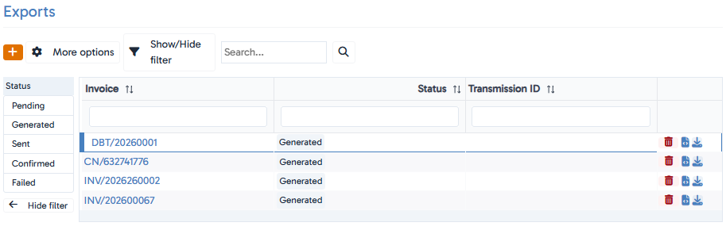
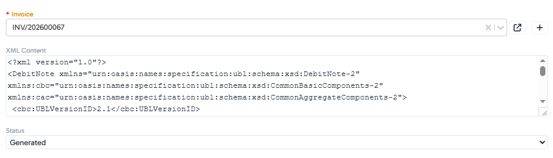
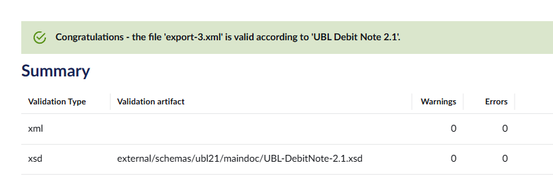

# Hubleto EInvoice

Hubleto EInvoice app for generating PEPPOL-compatible XML invoices.

## Description

The application allows users to select an invoice from the system. Upon selection, it automatically generates a valid PEPPOL-compatible XML file. The generated XML passes validation standards without fatal errors.

## Usage

1.  Select a desired invoice.
2.  Click Add to generate the export.
3.  The system automatically generates a valid PEPPOL-compatible XML file.
4.  Click the download XML button to download the selected XML file for validation purposes

## Screenshots

### Export List

### UBL 2.1 XML Output

### Validation Success

## Status

> **Work in Progress**

The application is in a functional state but is considered a Work in Progress.

*   **Core Functionality**: Generating correct XML from invoice data is done and usable.
*   **API Integration**: The app is ready for connecting to a provider's API.
*   **Visuals**: Minor UI/UX adjustments are needed.

## Known Limitations

*   **Debug Mode**: Some debug outputs and test parts are intentionally left in the code to assist with API integration tuning.
*   **Visuals**: Some UI elements might require further refinement.

## Dependencies

This application requires the **num-num** library to be installed.

> **IMPORTANT**: The `num-num` library is mandatory for this app to function.

*   [num-num/ubl-invoice](https://github.com/num-num/ubl-invoice)

## Credits

Special thanks to the **num-num** library used for UBL file generation.